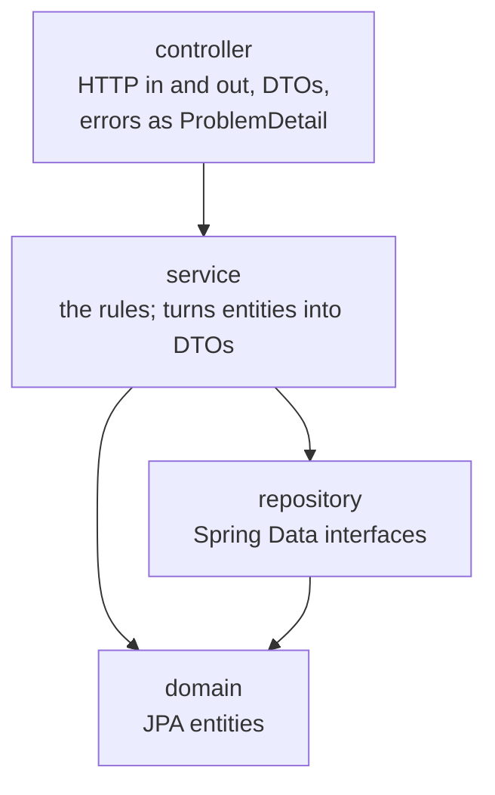

# 004 · The backend is split into layers that call one way

**Status:** Accepted

**Context:** The backend starts with ZEY-12. A Spring Boot app lets any class call any other:
a controller can read the database itself, and an entity can be returned straight as JSON.
Both work on the first day and leak later: column names reach the frontend, and the business
rules end up scattered across controllers. The course's week 5 asks for layer boundaries that a
test enforces.

**Options:**
- **Package by layer:** `controller`, `service`, `repository`, `domain`, each holding that kind of
  class for every feature.
- **Package by feature:** `product`, `order`, each holding its own controller, service and
  repository.
- **No rule:** keep classes where they fall and rely on review.

**Decision:** Package by layer, under `com.zeydem`:

- A controller calls only services. It never sees a repository or an entity.
- A service returns DTOs, so an entity never leaves the service and repository layers.
- The DTOs (`ProductResponse`…) and the one handler that turns every error into a
  `ProblemDetail` live in `controller`, because they are the shape of the HTTP answer.
- An ArchUnit test checks the arrows. A class that breaks one turns the build red and is named
  in the failure.

**Why this option:**
- The MVP has few features (products, orders, login); four packages stay small and each layer
  can be read in one place.
- Layers by package give ArchUnit a simple rule to check: "classes in `..controller..` do not
  depend on `..repository..` or `..domain..`".
- A rule in a test does not depend on anyone remembering it.

**Evidence:** `docs/architecture.md`, "Boundaries": controllers return DTOs, layers go one way,
ArchUnit fails the build on a controller that calls a repository.

**Trade-off accepted:**
- One feature is spread over four packages; a change to products touches several folders.
- A service maps every entity to a DTO, even when the two look the same today.
- Package by layer gets crowded as features grow.

**Revisit when:** a package holds so many classes that finding one feature's code is slow,
usually around the point a second large feature (orders, ZEY-25) is in. Package by feature,
with the same layers inside each, is the next step.
