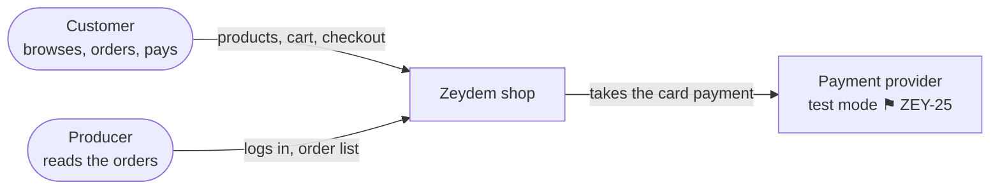
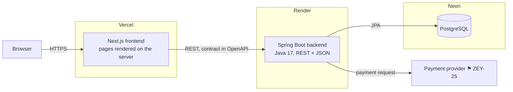
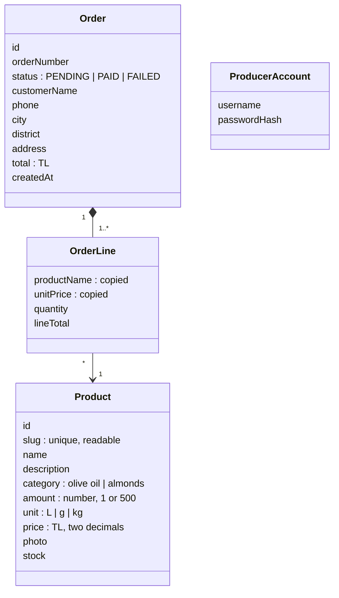

# Architecture

How the MVP is put together: who uses it, which parts run where, and what the data looks like.
Points still open are marked **⚑** with the ticket that decides them. The page layouts are in
`docs/features/design/sketches/`.

## Context

Who uses the shop, and which outside systems it depends on.

No customer accounts, no email, no shipping integration (see `docs/plan.md`).

## Containers

The parts that run separately, and how they talk.

| Container | Holds | Does not hold |
|---|---|---|
| Next.js frontend | Pages, components, the cart (in the browser's storage) | Prices it trusts, stock, orders |
| Spring Boot backend | Products, orders, the producer login, the payment call | HTML, display text |
| PostgreSQL | Products, orders, order lines | Card details (they stay with the provider) |

Locally the backend uses a PostgreSQL installed with Homebrew; the live one is on Neon. The
schema is created by Hibernate from the entities, and sample products come from an idempotent
seed SQL (ZEY-12).

## Boundaries

- **The browser does not call the backend.** Pages fetch on the Next.js server, so the backend
  address stays private and no CORS setup is needed. The one exception, if the provider needs
  it, is the payment provider calling the backend back (ZEY-25).
- **The contract comes first.** Each endpoint's request, response and errors are written in
  OpenAPI before either side. The frontend reads only contract fields.
- **Entities stay inside the backend.** Controllers return DTOs; column names, SQL and stack
  traces never cross. Errors use one shape, `ProblemDetail`, with the right HTTP status.
- **An error is not an empty list.** An empty list means "no products"; an error means "we do
  not know". The frontend shows them differently (ZEY-14, ZEY-15).
- **The server decides the price.** An order carries product ids and quantities; the backend
  looks up the prices and computes the total (ZEY-25).
- **Layers go one way.** In the backend: controller → service → repository. ArchUnit fails the
  build if a controller calls a repository directly (ZEY-12).
- **Components do not fetch.** Frontend components take props, so they can be tested without
  the backend.
- **Secrets stay on the server.** Payment keys and the producer password hash live in the
  backend's environment, never in a `NEXT_PUBLIC_` variable.

## Domain model

- **One product per size.** "Naturel Sızma Zeytinyağı 1 L" and "… 5 L" are separate products
  with their own slug, price and stock. Switching sizes on one page is out of the MVP.
- **Prices are TL with two decimals:** `NUMERIC(10,2)` in the database, `BigDecimal` in Java.
- **Amount and unit are separate fields,** not one text like "1 L". The page joins them for
  display; kept apart, they allow a price per litre or kilo if one has to be shown, without
  changing the contract.
- **An order line copies the product's name and price.** A later price change must not change
  a past order.
- **The order status** moves PENDING → PAID or PENDING → FAILED. The states and the payment
  flow are drawn in the ZEY-25 spec.
- **ProducerAccount** is the single login. Where it is stored and how the session works:
  ⚑ ZEY-28.

Which tickets add which fields:

| Field | Ticket |
|---|---|
| `Product`: name, photo, price, amount, unit | ZEY-12 |
| `Product`: slug, description | ZEY-13 |
| `Product`: stock | ZEY-19 (decremented at order time in ZEY-27) |
| `Product`: category | ZEY-34 |
| `Order`, `OrderLine`, status | ZEY-25 |
| `ProducerAccount` | ZEY-28 |
